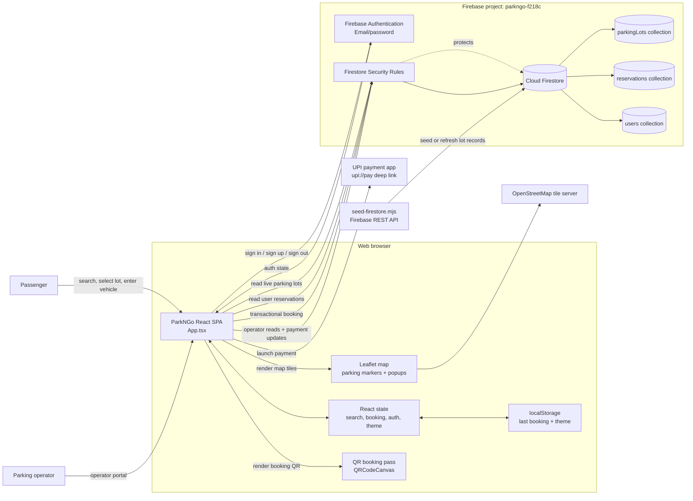
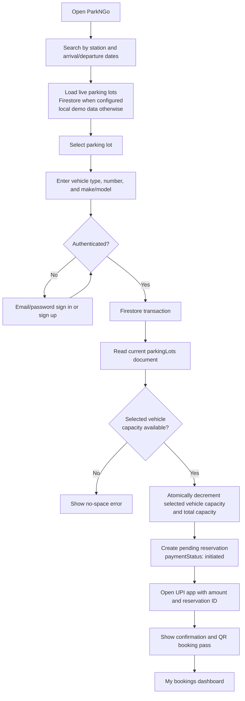
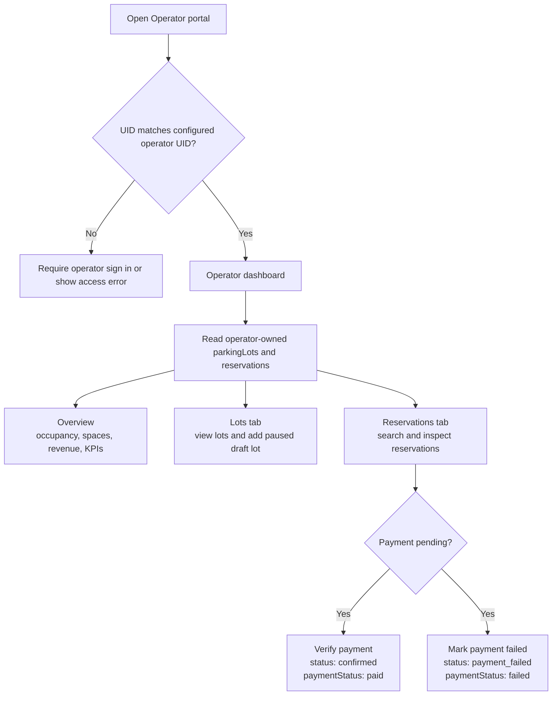
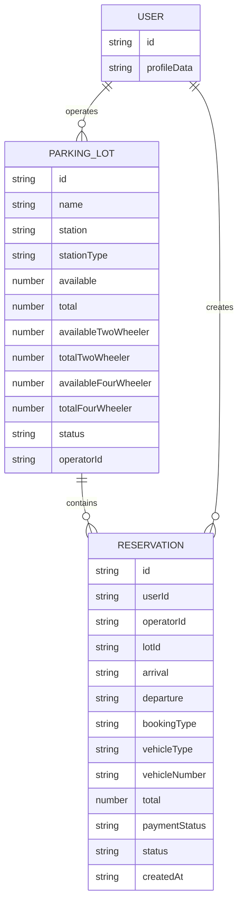

# ParkNGo Project Block Diagram

This diagram reflects the current implementation in `src/App.tsx`, `src/firebase.ts`,
`firestore.rules`, and `scripts/seed-firestore.mjs`.

## System Block Diagram

## Passenger Booking Flow

## Operator Flow

## Firestore Data Blocks

## Runtime and Deployment Notes

- `src/main.tsx` mounts the React application.
- `src/firebase.ts` initializes Firebase only when all `VITE_FIREBASE_*` values exist.
- Without Firebase configuration, the application uses local demo parking data and local booking state.
- Firestore rules make live lots publicly readable, restrict reservations to their owner or the operator, and restrict lot/payment mutations.
- `scripts/seed-firestore.mjs` writes the six Hyderabad/Telangana parking lots through the Firebase REST API.
- Firebase Firestore is configured in `asia-south1` through `firebase.json`.
- Payment settlement is not verified automatically. The UPI app is launched externally and the operator confirms or fails the payment in the portal.
- Availability is currently per parking lot and vehicle type. It is not yet split into per-day availability documents.
